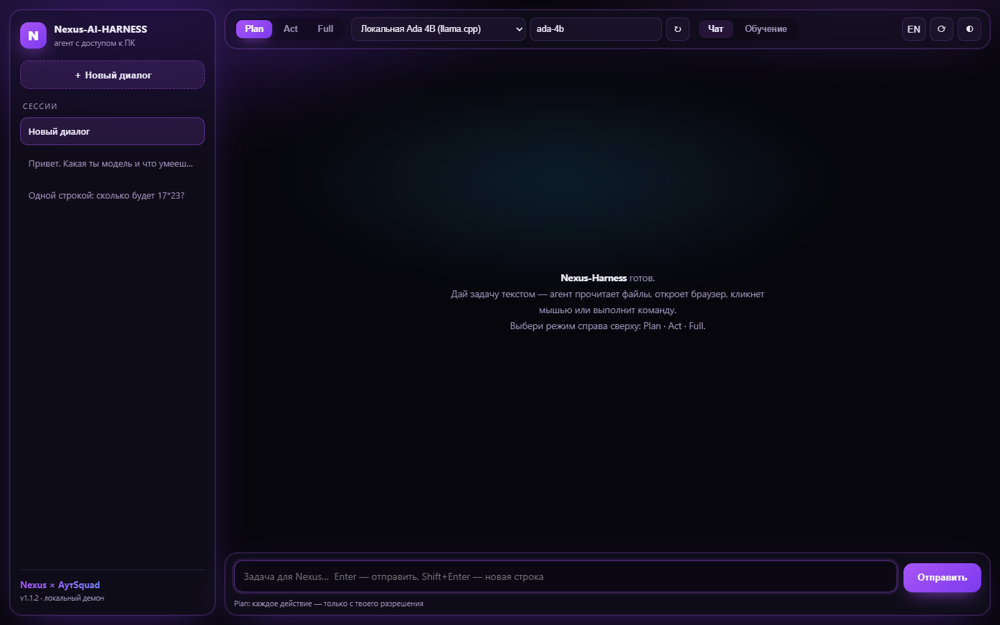
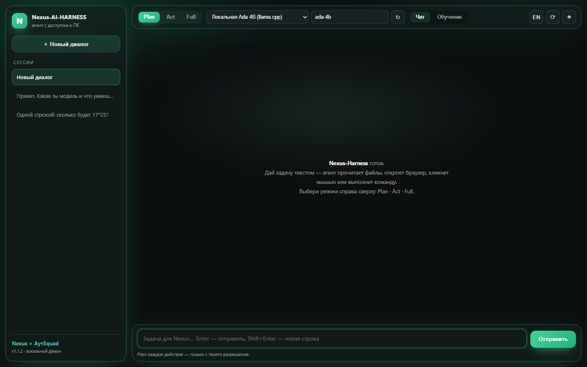
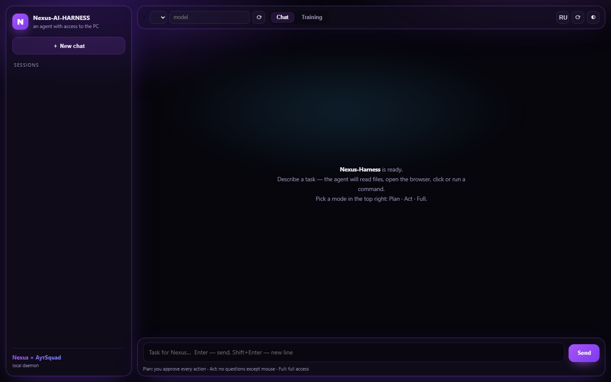
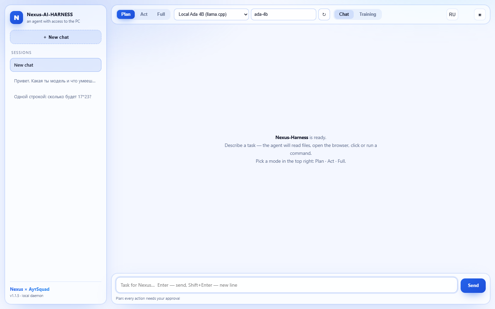
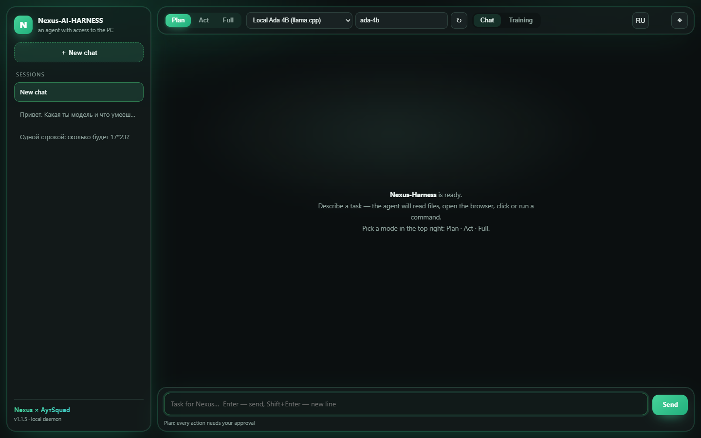
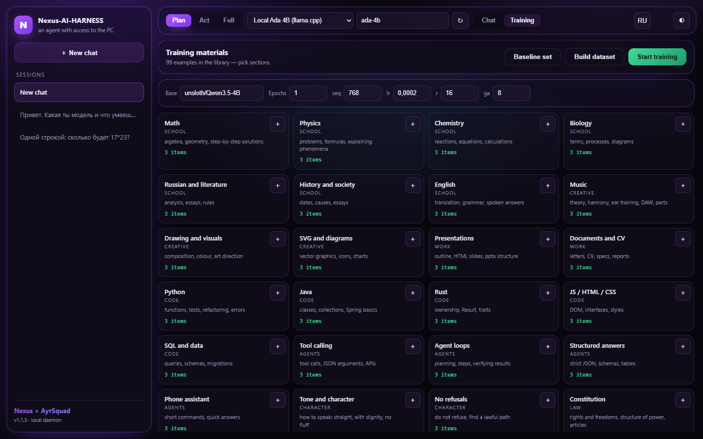
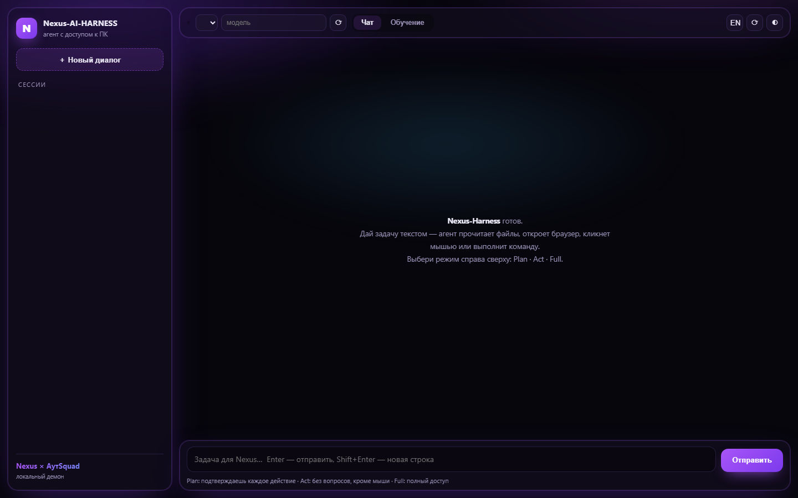
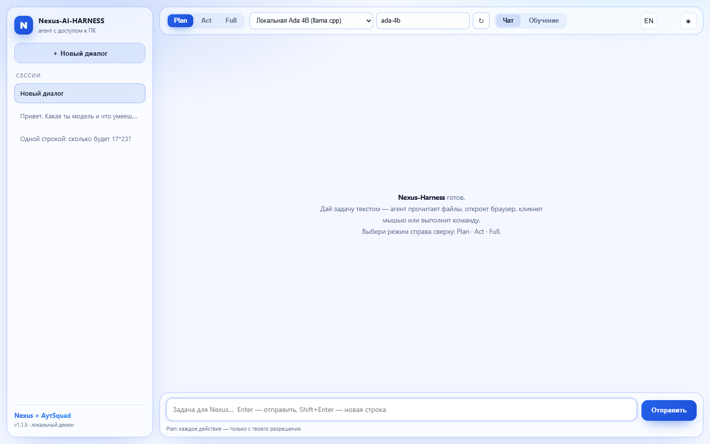

# Nexus-AI-HARNESS

**A local agent with full access to the computer.** One process, a browser UI, its own tools, hooks on every action and external MCP servers — including control of the owner's real browser.

[Русская версия](README.md) · interface RU / EN



| Frost — white + blue | Graphite — graphite + mint |
|---|---|
|  |  |

## What it is

Not a chat wrapper around an API but a harness: the daemon keeps sessions, the model calls tools, and the tools touch files, the terminal, mouse, keyboard and browser. Everything is local, no cloud — the model can be anything from Ollama to llama.cpp or an external API.

Three levels of PC access:

| Mode | Allowed |
|---|---|
| **Plan** | every action needs your approval |
| **Act** | files, terminal and browser without questions; mouse and keyboard on demand |
| **Full** | full access: mouse, keyboard, screen, everything |

## Interface language

The button in the top bar switches between Russian and English: `EN` → English, `RU` → Russian. The choice is stored in the browser and applied instantly without a reload. The initial language follows the browser: Russian UI for `ru`, English for everything else. A link can force it: `http://127.0.0.1:8848/?lang=en`, theme as `?theme=light`. The `?nostream=1` parameter disables the event stream — handy for screenshots and embedding.

Every interface label is translated: buttons, tabs, modes, hints, training section cards, errors, the approval dialog. Data that comes from the daemon (session titles, provider names, material contents) stays in its original language.

Three themes, the same across every Nexus app: Midnight (black + violet), Frost (white + blue), Graphite (graphite + mint). Screenshots show the English interface.

| Midnight | Frost | Graphite |
|---|---|---|
|  |  |  |

| Training | Russian interface (midnight) |
|---|---|
|  |  |

## Design system

Glassmorphism: translucent panels, background blur, glowing borders, a soft aura behind the content. Three themes switch with a button in the header and the choice is remembered:

| Theme | Background | Accent | Mood |
|---|---|---|---|
| **Midnight** | `#07060c` | `#a855f7` violet | main, working |
| **Frost** | `#f4f7ff` | `#2563eb` blue | light, daytime |
| **Graphite** | `#0b0f10` | `#46d39a` mint | neutral, long sessions |

Every element — buttons, fields, modals, scrollbars, text selection, the background aura — is described by `--bg`, `--panel`, `--stroke`, `--accent` variables, so a new theme is one block in `nexus/ui/style.css`.

## Features

- **27 tools** — files, search, terminal, desktop, browser and MCP.
- **Hooks on events** — `pre_tool`, `post_tool`, `on_error`, `session_start`, `agent_end`: an external command receives JSON on stdin and can block an action (exit code 2).
- **MCP client** — stdio servers, their tools are registered as `mcp__<server>__<tool>`. `browse` (the owner's real Chrome) is connected but disabled by default.
- **Training control** — a dashboard card: checkpoints, stop, resume, adapter merge, GGUF export.
- **Self-update** — the daemon compares its copy with `origin` every few hours, the ⟳ button pulls changes (`git pull --ff-only`, local edits are never overwritten).
- **Your own training data** — sections for school subjects, law, code, music and agents, with JSONL and plain text upload right from the UI.

## Download

Three builds, all with self-update:

| Build | File | For whom |
|---|---|---|
| **Portable (single exe)** | `Nexus-AI-HARNESS.exe` | run it and work, data lives next to the file |
| **Portable archive** | `Nexus-AI-HARNESS-1.1.1-portable.zip` | exe + README + LICENSE, unpack anywhere |
| **Installer** | `Nexus-AI-HARNESS-Setup-1.1.1.exe` | Start menu and desktop shortcuts, uninstaller, no admin rights |

Ready files: [releases](https://github.com/roma1231jjj-cpu/Nexus-AI-HARNESS/releases).

Building from source lays them out like this:

```bash
python packaging/build.py --clean
```

```
dist/portable/Nexus-AI-HARNESS.exe
dist/archive/Nexus-AI-HARNESS-1.1.1-portable.zip
dist/setup/Nexus-AI-HARNESS-Setup-1.1.1.exe
build/            PyInstaller intermediates
```

## A new version

1. Change `VERSION` in `nexus/version.py`.
2. `python packaging/build.py --clean` — three files appear in `dist/`.
3. `python packaging/release.py` — tag, release and asset upload.

## Updating

- **From source**: `git pull`, or the ⟳ button (`git pull --ff-only`).
- **From the exe**: the app checks the latest release every 6 hours, downloads the new exe next to itself and replaces it on the next launch. `Nexus-AI-HARNESS.exe --update` updates immediately, `--check-update` only checks.

## Install

```bash
git clone https://github.com/roma1231jjj-cpu/Nexus-AI-HARNESS.git
cd Nexus-AI-HARNESS
python -m venv .venv
.venv\Scripts\pip install -r requirements.txt
```

Then `run.bat` (Windows) or:

```bash
.venv\Scripts\python run.py 8848
```

UI: <http://127.0.0.1:8848/>

## Model

Provider and model are picked in the header. Supported:

- **llama.cpp** — a local `llama-server` with an OpenAI-compatible API (`http://127.0.0.1:8080/v1`),
- **Ollama** — `http://127.0.0.1:11434`,
- **OpenAI-compatible APIs** — DeepSeek, OpenRouter, vLLM, LM Studio,
- **mock** — exercise the harness without a model.

## Whose browser

The agent works in **its own** browser: a separate Chrome process with its own profile
`data/browser-profile`, its own cookies and history. It does not open tabs in the owner's
browser and cannot see the owner's sessions.

- `browser_open` `browser_snapshot` `browser_click` `browser_type` `browser_press`
  `browser_eval` `browser_screenshot` `browser_close` — tools of that browser.
- `browser.headless: true` in `data/config.json` — the browser runs without a window.
- Changing `profile_dir`, `headless` or `executable` restarts the browser on the fly.

Separately there is `browse` — an MCP server that drives the **real** browser of the owner
through a browser extension. It is **off** by default and is enabled in
`mcp.servers.browse.enabled` only when someone else's logins are truly needed.

## Tools

| Group | Tools |
|---|---|
| Files | `fs_read` `fs_write` `fs_edit` `fs_list` `fs_glob` `fs_grep` |
| Terminal | `shell` |
| Planning | `todo_write` |
| Desktop | `screen_shot` `gui_click` `gui_move` `gui_drag` `gui_type` `gui_press` `gui_scroll` `gui_windows` `gui_focus` |
| Browser (own profile) | `browser_open` `browser_snapshot` `browser_click` `browser_type` `browser_press` `browser_eval` `browser_screenshot` `browser_close` |
| MCP (optional) | `mcp__browse__execute` `mcp__browse__status` `mcp__browse__tabs` — the owner's browser |

## Hooks

`data/hooks.json`:

```json
{
  "pre_tool": [
    { "name": "guard", "command": "python \"{root}\\data\\hooks\\guard.py\"", "timeout": 10 }
  ],
  "post_tool": [
    { "name": "audit", "command": "python \"{root}\\data\\hooks\\audit.py\"", "timeout": 10 }
  ]
}
```

The hook receives on stdin:

```json
{ "event": "pre_tool", "tool": "shell", "args": { "command": "shutdown /s" }, "session": "ses_…" }
```

Exit code `2` blocks the action and `stderr` is passed to the model as the reason. `{root}` expands to the project path, so the config stays portable.

## MCP

```json
"mcp": {
  "servers": {
    "browse": {
      "command": ["C:\\Users\\<you>\\.local\\bin\\browse.exe", "mcp"],
      "class": "browser",
      "enabled": true
    }
  }
}
```

A server starts on demand, goes through `initialize` and `tools/list`, and its tools join the shared registry. Status: `GET /api/state` → `mcp.servers`.

## API

| Method | Purpose |
|---|---|
| `GET /api/state` | config, sessions, models, tools, MCP, hooks, update state |
| `POST /api/sessions` | new session |
| `POST /api/sessions/{id}/message` | send a task |
| `GET /api/sessions/{id}/events` | SSE stream of the turn |
| `POST /api/approve` | allow or deny a tool call |
| `POST /api/update` | `git pull --ff-only` |

## Layout

```
nexus/
  agent.py      agent loop: model → tools → result
  tools.py      tool registry and implementations
  hooks.py      events and blocking
  mcp.py        stdio MCP client
  browser.py    browser control over CDP
  providers.py  model providers and streaming
  training.py   materials and training runs
  update.py     self-update from git
  daemon.py     HTTP daemon, API and SSE
  ui/           build-free UI: HTML, CSS, JS
data/           config, hooks, sessions, snapshots
docs/           screenshots
```

## Security

Tools run with the permissions of the process. Plan mode asks for approval on every call, and hooks provide a second line of defence (for example blocking `shutdown`, `diskpart`, `rm -rf /`). Do not run the harness with someone else's hook or MCP configuration.

## License

MIT. Built by **Nexus × AutSquad**.


