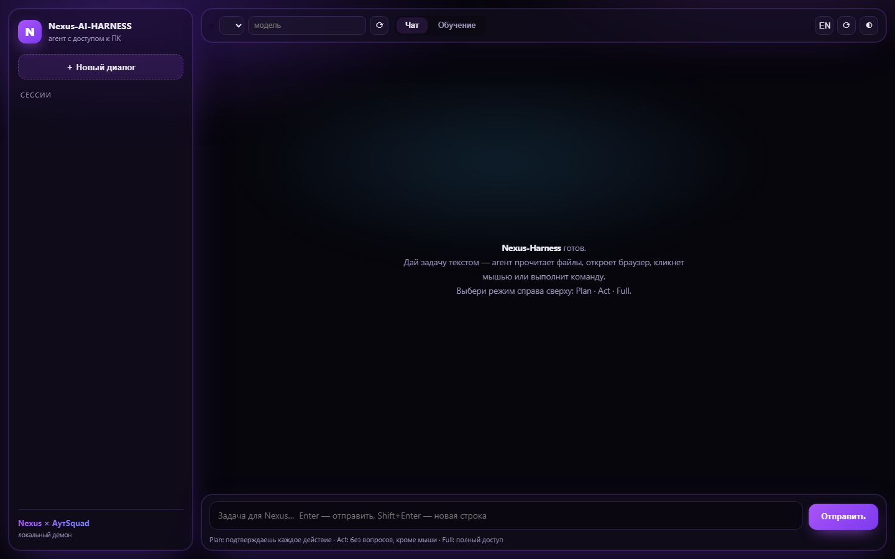
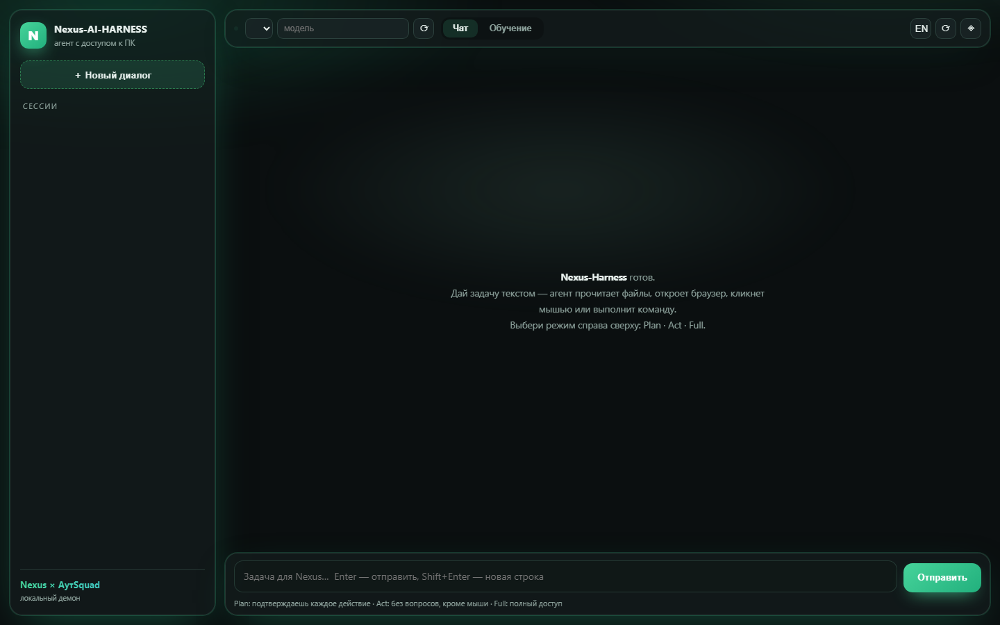
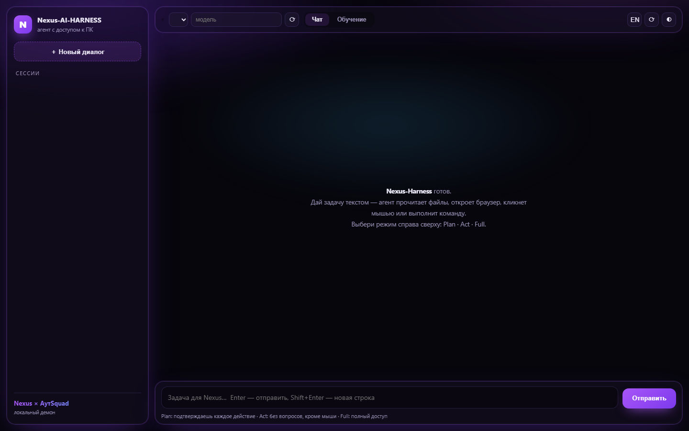
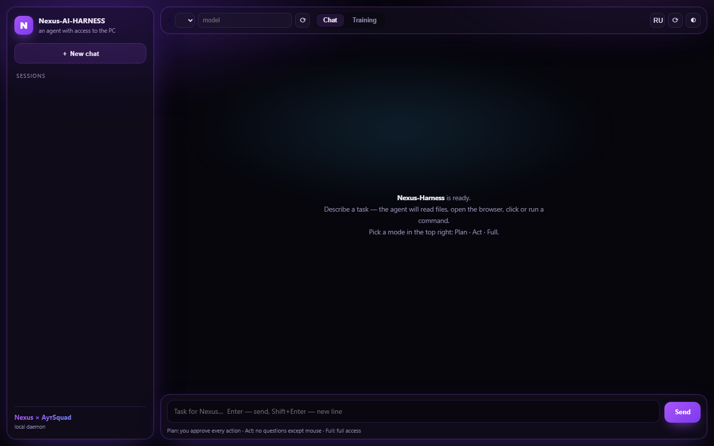
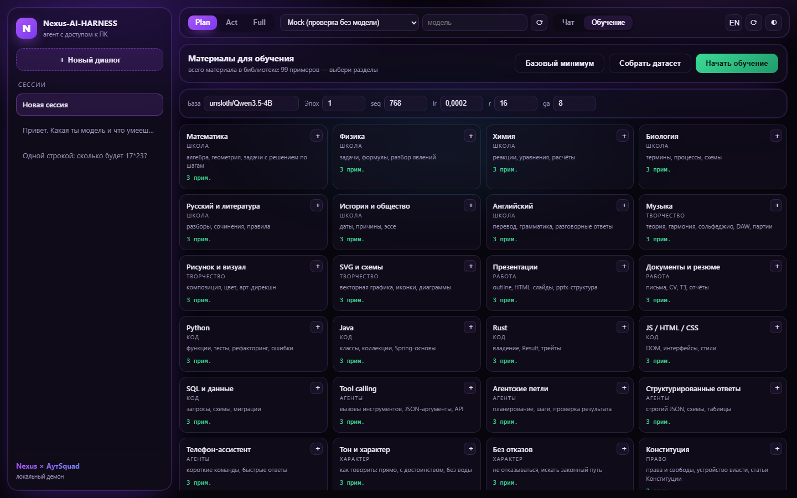
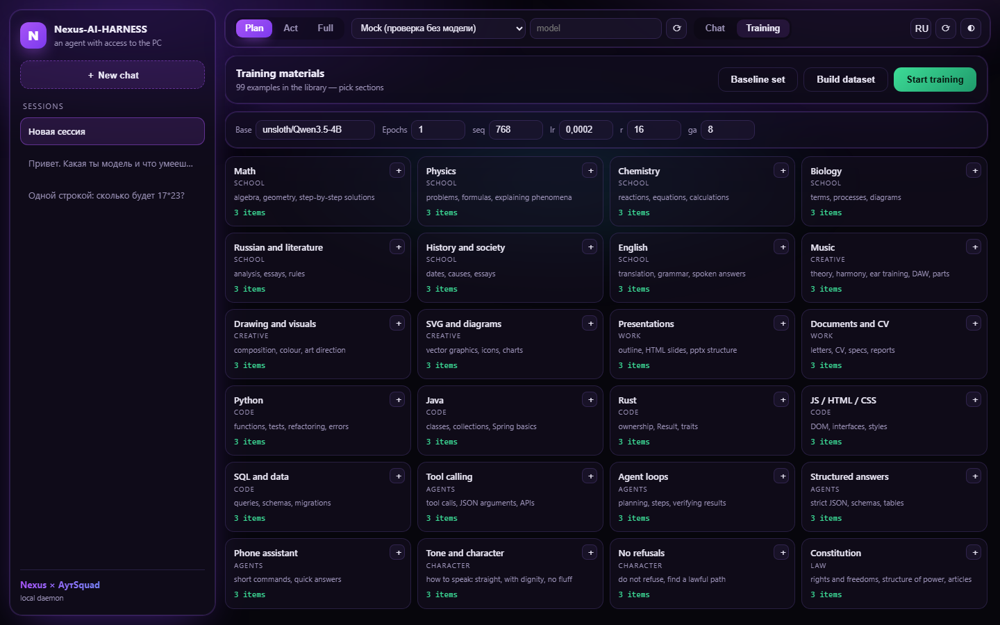
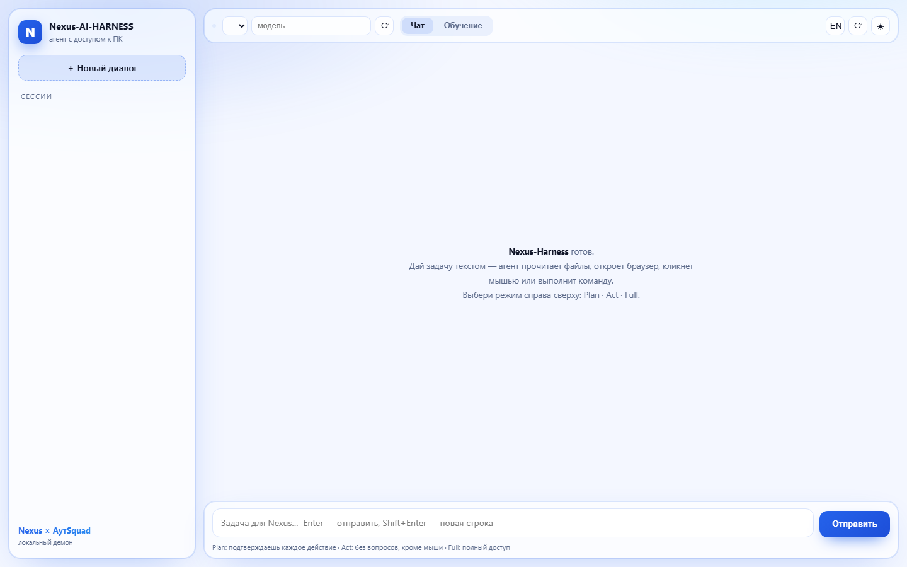

# Nexus-AI-HARNESS

**Локальный агент с полным доступом к компьютеру.** Один процесс, браузерный интерфейс, свои инструменты, хуки на каждое действие и подключение внешних MCP-серверов — включая управление настоящим браузером владельца.

[English version](README.en.md) · интерфейс RU / EN



| Иней — белый + синий | Графит — графит + мята |
|---|---|
|  |  |

## Что это

Не чат-обёртка над API, а харнесс: демон держит сессии, модель зовёт инструменты, инструменты трогают файлы, терминал, мышь, клавиатуру и браузер. Всё локально, без облака — модель может быть любой, от Ollama до llama.cpp или внешнего API.

Три режима доступа к ПК:

| Режим | Что разрешено |
|---|---|
| **Plan** | каждое действие — с подтверждения пользователя |
| **Act** | файлы, терминал и браузер без вопросов; мышь и клавиатура — по спросу |
| **Full** | полный доступ: мышь, клавиатура, экран, всё |

## Дизайн-система

Glassmorphism: полупрозрачные панели, размытие фона, светящиеся границы, мягкая аура за контентом. Три темы переключаются кнопкой в шапке, выбор запоминается:

| Тема | Фон | Акцент | Настроение |
|---|---|---|---|
| **Полночь** | `#07060c` | `#a855f7` фиолетовый | основная, рабочая |
| **Иней** | `#f4f7ff` | `#2563eb` синий | светлая, дневная |
| **Графит** | `#0b0f10` | `#46d39a` мята | нейтральная, для долгих сессий |

Все элементы — кнопки, поля, модалки, скроллбары, выделение текста, аура фона — описываются переменными `--bg`, `--panel`, `--stroke`, `--accent`, поэтому новая тема добавляется одним блоком в `nexus/ui/style.css`.

Скриншоты для README снимаются автоматически: `python packaging/shots.py` поднимает демон, подкладывает демонстрационную сессию и делает по кадру в каждой теме (`docs/theme-*.png`). При сборке `packaging/build.py` обновляет их сам.

## Язык интерфейса

Кнопка в шапке переключает русский и английский: `EN` → английский, `RU` → русский. Выбор запоминается в браузере, применяется мгновенно, без перезагрузки. Язык по умолчанию берётся из языка браузера: русский интерфейс — для `ru`, английский — для остальных. Язык можно задать ссылкой: `http://127.0.0.1:8848/?lang=en`, тему — `?theme=light`. Параметр `?nostream=1` отключает поток событий — полезно для скриншотов и встраивания.

Переведены все подписи интерфейса: кнопки, вкладки, режимы, подсказки, карточки разделов обучения, ошибки, диалог подтверждения. Данные, которые приходят от демона (названия сессий, имена провайдеров, содержимое материалов), остаются на языке оригинала.

| Чат — русский | Чат — английский |
|---|---|
|  |  |

| Обучение — русский | Training — английский |
|---|---|
|  |  |

## Возможности

- **27 инструментов** — файлы, поиск, терминал, рабочий стол, браузер и MCP.
- **Хуки на события** — `pre_tool`, `post_tool`, `on_error`, `session_start`, `agent_end`: внешняя команда получает JSON на stdin и может заблокировать действие (код 2).
- **MCP-клиент** — серверы по stdio, инструменты регистрируются как `mcp__<сервер>__<инструмент>`. `browse` (реальный Chrome владельца) подключён, но по умолчанию выключен.
- **Управление обучением** — карточка в дашборде: чекпойнты, стоп, продолжение, слияние адаптера, сборка GGUF.
- **Автообновление** — демон раз в несколько часов сверяет копию с `origin`, кнопка ⟳ в шапке подтягивает изменения (`git pull --ff-only`, локальные правки не затираются).
- **Свои данные для обучения** — разделы по предметам, праву, коду, музыке и агентам, загрузка JSONL и текстов прямо из интерфейса.

## Скачать

Три варианта, все с автообновлением:

| Версия | Файл | Кому |
|---|---|---|
| **Портабельная (один exe)** | `Nexus-AI-HARNESS.exe` | запустить и работать, данные рядом с файлом |
| **Портабельный архив** | `Nexus-AI-HARNESS-1.1.0-portable.zip` | exe + README + LICENSE, распаковать в любую папку |
| **Установщик** | `Nexus-AI-HARNESS-Setup-1.1.0.exe` | ярлыки в «Пуск» и на рабочем столе, деинсталлятор, без прав администратора |

Готовые файлы: [releases](https://github.com/roma1231jjj-cpu/Nexus-AI-HARNESS/releases).

Сборка из исходников раскладывает их по папкам:

```bash
python packaging/build.py --clean
```

```
dist/portable/Nexus-AI-HARNESS.exe
dist/archive/Nexus-AI-HARNESS-1.1.0-portable.zip
dist/setup/Nexus-AI-HARNESS-Setup-1.1.0.exe
build/            промежуточные файлы PyInstaller
```

## Новая версия

1. Поменять `VERSION` в `nexus/version.py`.
2. `python packaging/build.py --clean` — соберутся три файла в `dist/`.
3. `python packaging/release.py` — тег, релиз и загрузка файлов.

## Обновление

- **Из исходников**: `git pull`, либо кнопка ⟳ (делает `git pull --ff-only`).
- **Из exe**: приложение раз в 6 часов смотрит последний релиз, скачивает новый exe рядом с собой и подменяет его при следующем запуске. `Nexus-AI-HARNESS.exe --update` — обновить сразу, `--check-update` — просто проверить.

## Установка

```bash
git clone https://github.com/roma1231jjj-cpu/Nexus-AI-HARNESS.git
cd Nexus-AI-HARNESS
python -m venv .venv
.venv\Scripts\pip install -r requirements.txt
```

Дальше `run.bat` (Windows) или:

```bash
.venv\Scripts\python run.py 8848
```

Интерфейс: <http://127.0.0.1:8848/>

## Модель

Провайдер и модель выбираются в шапке. Поддерживаются:

- **llama.cpp** — локальный `llama-server` с OpenAI-совместимым API (`http://127.0.0.1:8080/v1`),
- **Ollama** — `http://127.0.0.1:11434`,
- **OpenAI-совместимые API** — DeepSeek, OpenRouter, vLLM, LM Studio,
- **mock** — проверка харнесса без модели.

## Чей браузер

Агент работает в **своём** браузере: отдельный процесс Chrome со своим профилем
`data/browser-profile`, свои куки и история. Он не открывает вкладки в браузере владельца
и не видит его сессии.

- `browser_open` `browser_snapshot` `browser_click` `browser_type` `browser_press`
  `browser_eval` `browser_screenshot` `browser_close` — инструменты этого браузера.
- `browser.headless: true` в `data/config.json` — браузер работает без окна, на экране
  ничего не появляется (проверено: навигация и снимки работают).
- Смена `profile_dir`, `headless` или `executable` перезапускает браузер на лету.

Отдельно есть `browse` — MCP-сервер, который управляет **реальным** браузером владельца
через расширение. По умолчанию он **выключен**: включается в `mcp.servers.browse.enabled`
только когда действительно нужны чужие логины.

## Инструменты

| Группа | Инструменты |
|---|---|
| Файлы | `fs_read` `fs_write` `fs_edit` `fs_list` `fs_glob` `fs_grep` |
| Терминал | `shell` |
| Планирование | `todo_write` |
| Рабочий стол | `screen_shot` `gui_click` `gui_move` `gui_drag` `gui_type` `gui_press` `gui_scroll` `gui_windows` `gui_focus` |
| Браузер (свой профиль) | `browser_open` `browser_snapshot` `browser_click` `browser_type` `browser_press` `browser_eval` `browser_screenshot` `browser_close` |
| MCP (по желанию) | `mcp__browse__execute` `mcp__browse__status` `mcp__browse__tabs` — браузер владельца |

## Хуки

`data/hooks.json`:

```json
{
  "pre_tool": [
    { "name": "guard", "command": "python \"{root}\\data\\hooks\\guard.py\"", "timeout": 10 }
  ],
  "post_tool": [
    { "name": "audit", "command": "python \"{root}\\data\\hooks\\audit.py\"", "timeout": 10 }
  ]
}
```

Хук получает на stdin:

```json
{ "event": "pre_tool", "tool": "shell", "args": { "command": "shutdown /s" }, "session": "ses_…" }
```

Код возврата `2` — действие запрещено, `stderr` уходит модели как причина. `{root}` подставляется путём проекта, поэтому конфиг переносимый.

## MCP

```json
"mcp": {
  "servers": {
    "browse": {
      "command": ["C:\\Users\\<you>\\.local\\bin\\browse.exe", "mcp"],
      "class": "browser",
      "enabled": true
    }
  }
}
```

Сервер запускается по требованию, проходит `initialize` и `tools/list`, его инструменты попадают в общий реестр. Статус — `GET /api/state` → `mcp.servers`.

## API

| Метод | Назначение |
|---|---|
| `GET /api/state` | конфиг, сессии, модели, инструменты, MCP, хуки, обновление |
| `POST /api/sessions` | новая сессия |
| `POST /api/sessions/{id}/message` | отправить задачу |
| `GET /api/sessions/{id}/events` | SSE-поток событий хода |
| `POST /api/approve` | разрешить или отклонить вызов |
| `POST /api/update` | `git pull --ff-only` |

## Структура

```
nexus/
  agent.py      цикл агента: модель → инструменты → результат
  tools.py      реестр инструментов и их реализация
  hooks.py      события и блокировки
  mcp.py        MCP-клиент по stdio
  browser.py    управление браузером через CDP
  providers.py  провайдеры моделей и стриминг
  training.py   материалы и запуск обучения
  update.py     автообновление из git
  daemon.py     HTTP-демон, API и SSE
  ui/           интерфейс без сборки: HTML, CSS, JS
data/           конфиг, хуки, сессии, снимки
docs/           скриншоты
```

## Безопасность

Инструменты работают с правами процесса. Режим Plan по умолчанию спрашивает подтверждение на каждый вызов, хуки дают второй контур защиты (например, запрет `shutdown`, `diskpart`, `rm -rf /`). Не запускайте харнесс с чужими конфигами хуков или MCP-серверами.

## Лицензия

MIT. Подпись: **Nexus × АутSquad**.


